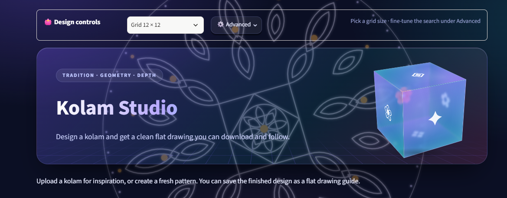
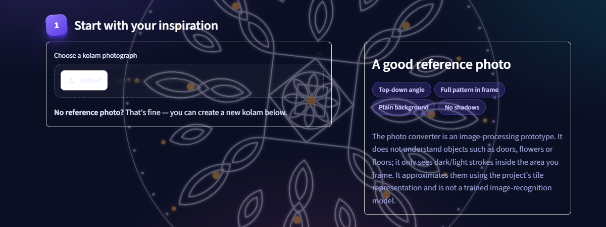
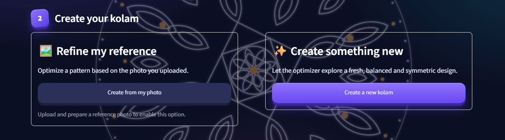
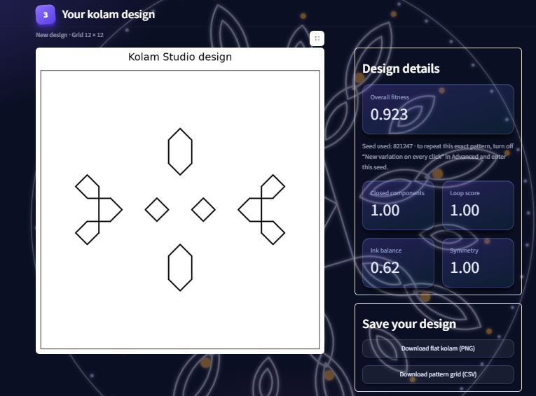

# KolamNet — GA-based Kolam Designer

A Python/Streamlit project based on the uploaded **KolamNet** report. It implements:
- Symmetry-preserving quadrant chromosome encoding.
- Genetic algorithm with tournament selection, quadrant-block crossover, mutation and elitism.
- Hill climbing and random-search baselines.
- Target recreation and target-free generative design fitness functions.
- Upload a kolam photo, approximate it as tile masks, optimize it, and export a drawable PNG / tile matrix.
- Reproducible benchmark runner that writes CSV results.

## Application Screenshots

### 1. Kolam Studio – Homepage

The main interface of KolamNet, where users can
select grid sizes and explore the application.



### 2. Upload a Reference Kolam

Users can upload an existing Kolam photograph
to recreate and optimize the pattern.



### 3. Create Your Kolam

Users can either refine an uploaded pattern
or generate a completely new Kolam design.



### 4. Generated Kolam Output

The application displays the generated pattern
along with its fitness score, closed components,
loop score, ink balance and symmetry.



## What's new in this version
- **New pattern on every click.** Previously the random seed was fixed at 42, so the same input always produced the same kolam. Now each click uses a fresh seed (shown under *Design details*). Untick *New variation on every click* under **Advanced** to get repeatable results.
- **Creativity slider (photo mode).** 0 = copy the photo as closely as possible (original behaviour); higher = blend in the symmetry / closed-loop goals so the output is inspired by the photo rather than a copy.
- **Photo preparation upgrades.** Pick the area of the photo that contains the kolam (pink box), an *Auto-find the pattern area* helper, *White lines on dark floor* for rice-flour kolams, *Ignore thick shapes* (doors, big flowers) and an automatic threshold. All off by default, so old behaviour is unchanged.
- **Deployable.** Dockerfile, `render.yaml`, `.streamlit/config.toml` and `DEPLOY.md` (see below).
- The genetic algorithm, fitness functions and tile encoding are unchanged.

### Does the model understand doors, flowers or the ground?
No. There is no object-recognition or floor-detection model here. The photo converter only looks at dark/light strokes inside the area you frame. The auto-finder is a classical heuristic (thin strokes vs. big solid shapes), so it can be fooled by garlands, kolam-like door patterns or strong shadows; check the pink box and adjust it by hand. Recognising "this is a door / this is the ground" would need a trained segmentation model, which this project does not include.

## Make it public (not just localhost)
See **DEPLOY.md** (Streamlit Community Cloud, Hugging Face Spaces, Render, or a temporary tunnel).

## Important dataset / training note
No verified public, labelled kolam image dataset is bundled. The report explicitly says its experimental targets were synthetic geometric patterns rather than traditional kolams. This implementation therefore uses synthetic test targets and an optimization algorithm, **not supervised machine-learning training**. A genetic algorithm does not learn weights from a dataset; it searches for high-fitness patterns. The photo upload feature is a prototype image-to-grid converter and works best with clean, top-down, high-contrast images.

## Windows: extract and run
1. Download `KolamNet_Project.zip`.
2. Right-click it → **Extract All…** → choose a folder.
3. Open the extracted `KolamNet_Project` folder.
4. In the folder address bar type `cmd` and press Enter.
5. Create a virtual environment:
   ```bat
   py -m venv .venv
   ```
6. Activate it:
   ```bat
   .venv\Scripts\activate
   ```
7. Install packages:
   ```bat
   python -m pip install --upgrade pip
   pip install -r requirements.txt
   ```
8. Start the app:
   ```bat
   streamlit run app.py
   ```
9. A browser tab should open. If not, copy the local URL printed in the terminal (usually `http://localhost:8501`).

## Run algorithm experiments (without the web interface)
In the same activated terminal:
```bat
python experiments.py --grid 8 --runs 5 --generations 80 --population 80 --task design
```
For target recreation:
```bat
python experiments.py --grid 8 --runs 5 --generations 80 --population 80 --task recreation
```
Results are saved to `benchmark_results.csv`.

## How to use the interface
### Recreate from a photo
1. Upload a top-down photo.
2. Click **Auto-find the pattern area**, then check the pink box and drag the sliders so it frames only the kolam.
3. Tick *White lines on dark floor* if the kolam is drawn in white powder; tick *Ignore thick shapes* if a door or large flowers are inside the box.
4. Click **Prepare this reference**, then **Create from my photo**. Click again for another variation.
5. Download the PNG / CSV. Use it as a drawing guide; it is not a guaranteed exact reconstruction.

### Generate a new kolam
1. Open **Generate a kolam**.
2. Choose grid size and GA parameters in the sidebar.
3. Click **Generate kolam**.
4. Download the PNG or CSV tile matrix.

### Compare algorithms
1. Open **Compare algorithms**.
2. Choose generative design or reference recreation.
3. Set independent runs and click **Run fair comparison**.
4. Compare mean fitness and standard deviation. Export the CSV.

## Algorithms and evaluation
- **GA**: tournament selection (k=3), block crossover (p=0.8), per-gene mutation (default 0.03), elitism.
- **Hill climbing**: one random gene change; accept non-decreasing fitness.
- **Random search**: sample candidates and retain the best.
- **Generative fitness**: `0.30*closure + 0.25*loops + 0.20*ink_balance + 0.25*symmetry`.
- **Recreation fitness**: `0.70*tile_similarity + 0.30*continuity`.

The score is an optimization **fitness**, not classification accuracy. For a fair comparison, methods should receive equal candidate-evaluation budgets and multiple random seeds.

## Project structure
```
KolamNet_Project/
├── app.py
├── kolamnet.py
├── experiments.py
├── requirements.txt
├── Dockerfile / .dockerignore / render.yaml
├── .streamlit/config.toml
├── run_windows.bat / run_mac_linux.sh
├── DEPLOY.md
├── README.md
└── docs/
    └── project_basis.md
```

## Known limitations
- The tile vocabulary is deliberately small (8 masks); diagonal and richer interlaced kolam strokes are not represented.
- Four-fold symmetry is enforced for generated candidates.
- The uploaded-photo converter samples cell-side midpoints; it cannot robustly understand arbitrary perspective, curved freehand strokes, occlusion or clutter.
- The current synthetic target generator is for software testing, not a traditional kolam dataset.
- A high fitness does not prove that a design is a single continuous hand-drawn stroke. Inspect the output before using it physically.
